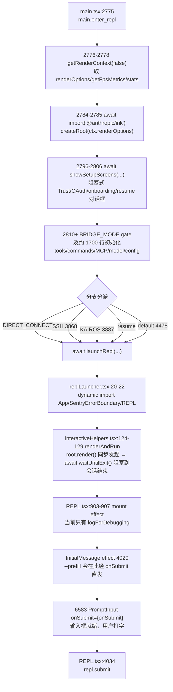

## 用户需求（原始表述）

> main.enter_repl 到repl.submit input之间走了什么链路，辛苦梳理下，然后加相关日志

## 需求澄清与补全

**目标链路**：交互 REPL 模式下，从 `main.enter_repl` 打点到 `repl.submit` 打点之间的完整执行路径。

**两项交付**：

1. **梳理**：给出链路的阶段性说明（谁调用谁、哪里阻塞、哪里是异步边界）
2. **加日志**：用既有的 `learningLog` 在这条链路上补齐关键点位，使 `tail -f ~/.claude/debug/learning-latest.log` 能按时间顺序还原一次启动到用户按下回车的全过程

## 核心功能点

- **分段可观测**：把这条链路切成若干语义阶段（Ink 容器创建 → 阻塞式对话框 → 初始化 → REPL 挂载 → 输入框就绪 → 提交），每段用 `learningLog` 成对或单点标记
- **耗时可推导**：`learningLog` 每行自带 `+Nms`，阶段耗时用相邻两条相减即可，**不引入新的计时 helper**
- **分支可辨识**：`launchRepl` 有 5 个不同调用分支，日志需带 `branch` 字段区分
- **修正既有缺陷**：现有 `main.launchRepl`(3885)、`main.launchRepl2`(4184) 位置错误（实际在会话退出后才打印），需一并修正
- **不改行为**：仅新增日志调用，不改变任何控制流、不改变异常处理、不动 `feature()` 判断条件

## 边界与约束

- 仅限**交互 REPL 模式**，不覆盖 `print/-p` 非交互路径
- 不输入框按键热路径（每次按键都会走）上埋点，避免日志膨胀
- 不新增 `learningLog.ts` 的导出（此前虚构 `ifStage` helper 已导致过 TS2305 事故）

## 技术栈

- 运行时：Bun 1.3.14（本机），Node v24.21.0
- 语言：TypeScript 6.0.3 + React（Ink TUI，`@anthropic/ink`）
- 日志：项目自建 `src/utils/learningLog.ts`，导出 `learningLog(stage, fields?)` / `flushLearningLog()` / `isLearningLogEnabled()` / `getLearningLogPath()`
- 现有辅助：`profileCheckpoint(...)`（main.tsx 已有）、`queryCheckpoint(...)`（REPL.tsx 已有）、`logForDebugging(...)`（debug 通道，与 learning 通道互不干扰）

## 实现思路

**核心策略**：纯增量埋点 —— 在已核实的链路锚点插入 `learningLog(...)` 调用，**不新增模块、不新增导出、不改变控制流**。

**为什么只用 `learningLog` 而不加 helper**：`learningLog` 已在 `learningLog.ts` 中对字段做了统一处理 —— `formatFieldValue` 会折叠空白为单行、超过 200 字符只保留 `<N chars>` 摘要、`function` 类型直接丢弃、`Error` 取 `name: message`；写入走 `createBufferedWriter`（200ms 刷盘间隔 / 256 条上限），并由 `registerCleanup` 保证进程退出前落盘。这些能力已经足够，包一层 helper 只会增加表面积。

**为什么不引入新的计时机制**：`learningLog` 输出形如 `[learning] +1234ms main.xxx`，自带相对起点毫秒。阶段耗时 = 相邻两条 `+Nms` 之差。新增 start/end 计时 helper 属于重复造轮子。

## 已核实的链路（关键结论）



**三条关键事实**（决定了埋点位置）：

1. **`await launchRepl(...)` 直到会话结束才返回**。`interactiveHelpers.tsx` 的 `renderAndRun` 实现是 `root.render(element)` → `startDeferredPrefetches()` → `await root.waitUntilExit()` → `await gracefulShutdown(0)`。因此**任何写在 `await launchRepl(...)` 之后的语句，都要等用户退出 REPL 才执行**。

2. **由此暴露既有缺陷**：`main.launchRepl`(main.tsx:3885) 和 `main.launchRepl2`(main.tsx:4184) 都位于各自 `await launchRepl(...)` 的 `);` 之后，实际在会话结束后才打印，名字与语义完全相反。同时 default 分支(4478-4487) 前后都无任何 learningLog。

3. **`showSetupScreens` 是本链路最大的耗时源**。main.tsx:2787-2790 的注释明确记载："p99 曾约 70s，被 dialog-wait 支配，不是代码路径本身慢"。这段必须成对打点。

## 架构设计

维持现有分层，零新增抽象：

```
埋点层（本次新增，全部为单行 learningLog 调用）
    ↓ 依赖（单向）
src/utils/learningLog.ts   ← 唯一写入口，不修改
```

数据流：启动过程触发埋点 → `learningLog()` → `getWriter()` 缓冲 → `appendFileSync` → `~/.claude/debug/learning-<时间戳>.log`（+ `learning-latest.log` 软链）。

## 目录结构

本次共涉及 3 个文件，全部为 [MODIFY]，无新增文件。

```
src/
├── main.tsx                          # [MODIFY] 链路的 CLI 侧宿主
│   ├── 2785 后：新增 main.ink_root_ready，标记 Ink 渲染容器创建完成
│   ├── 2798 前：新增 main.setup_screens_start，标记进入阻塞式对话框
│   ├── 2806 后：新增 main.setup_screens_end，字段 { onboardingShown }
│   ├── 3868 前：main.launch_repl 前置（branch:'ssh'），删除原 3885 的错位日志
│   ├── 4142 前：main.launch_repl 前置（branch:'resume'），删除原 4184 的错位日志
│   ├── 4478 前：新增 main.launch_repl（branch:'default'）—— 该分支此前完全无日志
│   └── DIRECT_CONNECT / KAIROS 分支：同样前置 main.launch_repl 并带 branch 字段
│
├── replLauncher.tsx                  # [MODIFY] REPL 挂载入口（当前 31 行，零埋点）
│   ├── 第 22 行后（三个 dynamic import 完成后）：新增 repl.launcher_loaded
│   └── 第 23 行前（调用 renderAndRun 之前）：新增 repl.first_render
│
└── screens/
    └── REPL.tsx                      # [MODIFY] REPL 组件本体
        └── 903-907 mount useEffect 内：新增 repl.mount（字段 { disabled }），
            与既有 logForDebugging 并列，保持两条通道互不干扰
```

**埋点清单（stage 命名统一为 snake_case，与 main.enter_repl / repl.submit 主流风格一致）**：

| stage | 位置 | 字段 | 作用 |
| --- | --- | --- | --- |
| `main.ink_root_ready` | main.tsx ~2786 | — | 标记 Ink 容器就绪 |
| `main.setup_screens_start` | main.tsx ~2797 | — | 进入阻塞对话框 |
| `main.setup_screens_end` | main.tsx ~2807 | `onboardingShown` | 对话框结束，与 start 相减得用户等待耗时 |
| `main.launch_repl` | main.tsx 5 个分支前置位 | `branch` | 替换并统一原错位的两个埋点 |
| `repl.launcher_loaded` | replLauncher.tsx ~22 | — | 三个动态 import 完成 |
| `repl.first_render` | replLauncher.tsx ~23 | — | 即将 root.render |
| `repl.mount` | REPL.tsx 904-907 | `disabled` | REPL 组件挂载，与既有 `[REPL:mount]` debug 日志并列 |


## 实施注意事项（防回归）

- **`feature()` 位置约束（本项目特有陷阱）**：`feature()` 来自 `bun:bundle`，是编译期宏，**只能出现在 `if` 条件或三元条件中**，写成 `learningLog('x', { enabled: feature('FLAG') })` 会在 `bun build` 时报错。而它在 `src/types/internal-modules.d.ts` 中被声明为普通 `(name: string) => boolean`，tsconfig `include` 含 `src/**/*.ts`，所以 **tsc 和 VS Code 诊断永远发现不了这个违规**。本次改动集中在 main.tsx 这类 `feature(...)` 密集区域，**验收必须双通道**。
- **禁止虚构函数**：只调用 `learningLog`。新增任何 helper 前必须先确认目标导出真实存在（本会话已因虚构 `ifStage` 出过 TS2305）。
- **不碰热路径**：`PromptInput` 的按键处理每次击键都会执行，**不要**在那里埋点。`onSubmit`（每次回车一次）已有 `repl.submit`，足够。
- **保持 buffer 友好**：`repl.submit` 现有字段含 `input`（用户原文），`formatFieldValue` 已有 200 字符截断保护，本次新增字段均沿用该机制，无需额外处理。
- **向后兼容**：`main.launchRepl` / `main.launchRepl2` 两个 stage 名会被 `main.launch_repl` 取代。若担心已有分析脚本依赖旧名，可在同一次调用中保留二者 —— 但建议直接统一，并在交付说明中标注该变更。
- **最小改动**：不动 `showSetupScreens`、`renderAndRun`、`REPL` 的任何签名或逻辑分支；`learningLog.ts` 一字不改。

## 验收方式（必须双通道）

1. `bun run typecheck` —— 检查类型
2. `bun build --target=bun src/main.tsx` —— **唯一能发现 `feature()` 位置约束违规的检查**
3. 实跑交互 REPL 并 `tail -f ~/.claude/debug/learning-latest.log`，确认日志按 `main.enter_repl → main.ink_root_ready → main.setup_screens_start → main.setup_screens_end → main.launch_repl → repl.launcher_loaded → repl.first_render → repl.mount → repl.submit` 顺序出现

**仅凭第 1 步通过就宣称完成是假通过**（本会话已犯过一次）。