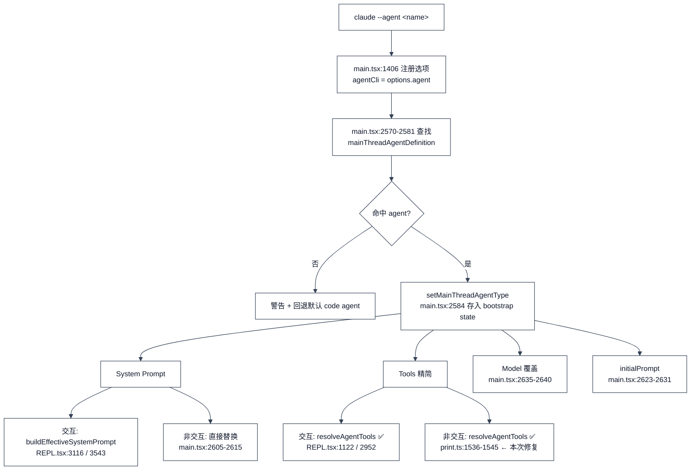

# PR 说明：运行指定 agent（`--agent` 参数 + `/agent名` slash 命令）

> 分支：`1124-config-agent-mode`
> 需求：让 `.claude/agents/` 下的某个 agent 以两种方式被触发，从而不运行默认 code agent，实现个性化的 system prompt 和 tool 精简以节省 token：
> 1. **命令行**：`claude --agent <name>` 直接指定；
> 2. **交互式**：直接输入 `/agent名`（如 `/hello-agent`）一步触发，无需先 `/agent` 再选择。
> 引用格式统一为 `文件路径:行号`。

---

## 0. TL;DR（这个 PR 到底干了啥）

在 Claude Code 里，你可以用两种方式让某个**自定义 agent**（定义在 `.claude/agents/*.md`）接管当前会话，从而：

1. 用该 agent 的 **system prompt** 替换默认的 code agent 提示词（个性化身份/指令）；
2. 只给模型下发该 agent 声明的 **tools 白名单**（`tools` / `disallowedTools` 字段），**少下发工具 = 少消耗 token**。

两种触发方式：
- **命令行**：`claude --agent <名字>`；
- **交互式**：直接敲 `/agent名`（如 `/hello-agent`）一步切换，等价于 `/agent <名字>` 但少一步选择。

本次 PR 做了三件事：
1. 补齐**非交互模式**（`claude -p "..."`、SDK）的工具精简链路——此前它根本没裁剪工具；
2. 让每个自定义 agent 自动注册成一条 **slash 命令**（`/agent名` 直接触发）；
3. 修掉一个阻碍编译的类型错误（`agentMode.ts`）。

---

## 1. 背景知识（给第一次接触这个项目的人）

### 1.1 什么是 agent（`.claude/agents/*.md`）

一个 agent 就是一个 Markdown 文件，头部是 YAML frontmatter，正文是 system prompt。例如：

```markdown
---
name: code-reviewer
description: 专门做代码评审的 agent
tools: Read, Grep, Glob
disallowedTools: Bash
model: haiku
---

你是一名严格的代码评审专家……
```

- `name` → 运行时叫 `agentType`，是 `--agent` 后面跟的名字；
- `description` → `whenToUse`，告诉模型"什么时候用我"；
- `tools` → 白名单，这个 agent 只能用这些工具；
- `disallowedTools` → 黑名单，这个 agent 不能用这些工具；
- 正文 → `getSystemPrompt()` 返回的内容。

这些文件由 `packages/builtin-tools/src/tools/AgentTool/loadAgentsDir.ts` 统一解析成 `AgentDefinition` 对象。

### 1.2 什么是 system prompt 和 tools，为什么能省 token

- **system prompt**：每次请求都发给模型的"角色设定 + 规则"文本。不同 agent 用不同提示词。
- **tools**：模型可以调用的工具集合（读文件、改文件、跑命令、搜索等）。每个工具都有名字 + 一段 JSON schema 描述，**这些描述要占用输入 token**。

默认 code agent 会挂载全部几十个工具，工具描述本身就很吃 token。如果自定义 agent 只需要 `Read` + `Grep` 两个工具，那下发的工具描述就从"几十个"变成"两个"，**大幅节省 token**——这就是需求里"tool 节省 token"的含义。

### 1.3 交互模式 vs 非交互模式

| 模式 | 怎么触发 | 主入口 |
|---|---|---|
| 交互模式（REPL） | 直接敲 `claude` | `src/screens/REPL.tsx` |
| 非交互模式 | `claude -p "..."`、SDK 流式调用 | `src/cli/print.ts`（`runHeadless` / `runHeadlessStreaming`） |

两条模式是**两套独立代码路径**，工具组装逻辑不共享。

---

## 2. 整体数据流（`--agent` 生效的完整链路）



**关键点**：交互模式和非交互模式，最终都统一用 `resolveAgentTools()` 这个函数来裁剪工具。本次 PR 之前，只有交互模式调了它，非交互模式没调。

---

## 3. 本次改动的文件与每一处 diff 的含义

涉及 4 个文件（新增 1 个、修改 3 个）+ 删除 `/agent` 命令目录，共 8 处改动。

### 3.1 `src/cli/print.ts` —— 核心修复（非交互模式工具精简）

非交互模式的主逻辑在 `runHeadlessStreaming`（`print.ts:1013` 起）里。它负责组装要发给模型的工具列表，组装函数叫 `buildAllTools`。

#### 改动 A：新增 import（`print.ts:41`）

```ts
import { resolveAgentTools } from '@claude-code-best/builtin-tools/tools/AgentTool/agentToolUtils.js'
```

**是什么意思**：把 `resolveAgentTools` 这个"按 agent 配置裁剪工具"的函数引进来。它是交互模式 REPL 已经在用的同一个函数（`REPL.tsx:291` 也 import 它）。本次让非交互模式复用同一套裁剪逻辑，保证两边行为一致。

#### 改动 B：解析当前 agent 定义（`print.ts:1500-1509`）

```ts
const mainAgentType = options.agent ?? getMainThreadAgentType()
const mainThreadAgentDefinition = mainAgentType
  ? agents.find(a => a.agentType === mainAgentType)
  : undefined
```

**是什么意思**：
- `options.agent` 是命令行 `--agent` 传进来的字符串；
- `getMainThreadAgentType()` 是 `main.tsx` / 会话恢复（`sessionRestore.ts`）已经写入全局状态的 agent 名字；
- 两者取一个（`??` 表示前者为空才用后者），再在 `agents` 列表里找到对应的 `AgentDefinition` 对象。

为什么要同时看两个来源？因为 agent 有三种入口：命令行 `--agent`、配置文件里的 `agent` 设置、以及"恢复上次会话"时带出的 agent。`getMainThreadAgentType()` 是这三个入口统一写入的"最终结果"，所以用它能一个不漏地覆盖。

#### 改动 C：在组装工具时应用裁剪（`print.ts:1532-1545`）

```ts
if (mainThreadAgentDefinition) {
  allTools = [
    ...resolveAgentTools(
      mainThreadAgentDefinition,
      allTools,
      false,
      true,
    ).resolvedTools,
  ]
}
```

**是什么意思**：
- `allTools` 是即将发给模型的完整工具列表；
- `resolveAgentTools(agent, tools, isAsync, isMainThread)` 按 agent 的 `tools` 白名单 / `disallowedTools` 黑名单把 `allTools` 过滤成 `resolvedTools`；
- 两个布尔参数：`false` = 不是异步子代理；`true` = 是主线程（跳过子代理专属的禁用规则，和 REPL 传参完全一致）；
- 外面包一层 `[...]` 是因为 `resolvedTools` 是只读数组，而 `allTools` 是可变数组，用展开运算符做个拷贝以通过类型检查。

**放置位置有讲究**：这段代码放在 `SyntheticOutputTool` 注入（`print.ts:1546` 起的 `createSyntheticOutputTool`）**之前**，因为这个合成工具是结构化输出（`--json-schema`）的内部实现细节，注释里明确说了它"不应参与普通过滤"（见 `main.tsx:2383-2385`）。放在它之前，agent 的白名单就不会误伤这个系统工具。

### 3.2 `src/agentMode/agentMode.ts` —— 类型修复

`agentMode` 模块用模块级变量 `currentAgentDefinition` 保存"当前激活的 agent"，供 `/agent` 命令运行时切换使用。

#### 改动 D：import 加 `isBuiltInAgent`（`agentMode.ts:1-4`）

```ts
import {
  isBuiltInAgent,
  type AgentDefinition,
} from '@claude-code-best/builtin-tools/tools/AgentTool/loadAgentsDir.js'
```

**是什么意思**：引入一个类型守卫函数 `isBuiltInAgent`。它能在运行时判断一个 agent 是"内置 agent"（如 plan / explore）还是"用户自定义 agent"。

#### 改动 E：`getActiveAgentSystemPrompt` 类型收窄（`agentMode.ts:72-82`）

```ts
export function getActiveAgentSystemPrompt(): string | null {
  if (!currentAgentDefinition) {
    return null
  }
  if (isBuiltInAgent(currentAgentDefinition)) {
    return null
  }
  return currentAgentDefinition.getSystemPrompt()
}
```

**是什么意思**：`AgentDefinition` 是一个联合类型——内置 agent 的 `getSystemPrompt()` **需要传参**（要 `toolUseContext`），而自定义 agent 的 `getSystemPrompt()` **不需要传参**。原来直接无参调用 `currentAgentDefinition.getSystemPrompt()`，TypeScript 会报 `TS2554: Expected 1 arguments, but got 0`（对内置 agent 类型而言）。

修法是先 `isBuiltInAgent` 收窄：内置 agent 在这里拿不到 `toolUseContext`，直接返回 `null`；剩下的一定是自定义 agent，无参调用类型就正确了。这同时把"内置 agent 在这个上下文拿不到提示词"这一事实显式化了。

### 3.3 `src/commands.ts` —— 每个自定义 agent 自动成为 slash 命令

用户输入 `/xxx` 后，系统会拿 `xxx` 去命令列表里精确匹配（`findCommand`，`commands.ts:797`），找到就执行。所以要让 `/hello-agent` 直接触发，核心就是**让每个 agent 的名字出现在命令列表里**。

命令列表由 `loadAllCommands`（`commands.ts:597` 起）组装，原来只含 skills / 插件 / workflow / 内置命令，不含 agent。本次新增了一个 agent 命令源。

#### 改动 F：新增 `getAgentSlashCommands`（`commands.ts:556-591`）

```ts
async function getAgentSlashCommands(cwd: string): Promise<Command[]> {
  const {
    getAgentDefinitionsWithOverrides,
    getActiveAgentsFromList,
    isBuiltInAgent,
  } = await import('@claude-code-best/builtin-tools/tools/AgentTool/loadAgentsDir.js')

  const { allAgents } = await getAgentDefinitionsWithOverrides(cwd)
  const activeAgents = getActiveAgentsFromList(allAgents)

  return activeAgents
    .filter(agent => !isBuiltInAgent(agent))   // 只注册自定义 agent，跳过内置
    .map(agent => ({
      type: 'local',
      name: agent.agentType,
      description: agent.whenToUse,
      supportsNonInteractive: false,
      disableModelInvocation: true,            // 不让模型自己调它
      load: async () => {
        const { switchToAgent } = await import('./agentMode/switchAgent.js')
        return {
          call: ((_args) =>
            switchToAgent(agent.agentType)) as LocalCommandCall,
        }
      },
    }))
}
```

**每个字段/逻辑是什么意思**：
- `type: 'local'` → 一条"本地纯函数"命令，执行后返回文本、不发给模型（区别于 `prompt` 类型会展开成输入发给模型）；
- `name: agent.agentType` → 命令名就是 agent 名，所以 `/hello-agent` 能被精确匹配上；
- `description: agent.whenToUse` → frontmatter 里的 `description`，输入 `/` 时自动补全/帮助会显示；
- `filter(agent => !isBuiltInAgent(agent))` → 只注册自定义 agent（`.claude/agents/*.md`、插件、settings），跳过 plan / explore 等内置 agent——内置 agent 是给子代理工具用的、不是主线程身份，且它们的 prompt 需要 `toolUseContext`，slash 命令给不了；
- `disableModelInvocation: true` → 禁止模型自己调用这条命令（切换主线程身份是用户动作，模型要用子代理走的是 AgentTool 而不是 slash 命令）；
- `load` 里的 `switchToAgent(agent.agentType)` → 调用 agentMode 里抽出的切换函数，把 agent 名传进去，于是 `/hello-agent` 一步切换（`setCurrentAgentDefinition` + `clearSystemPromptSections`）。

**为什么用动态 `import()`**：`loadAgentsDir` 所在的 AgentTool 技术栈会反过来依赖 `commands.ts`（`runAgent.ts` 里用了 `getCommand`），顶层静态 import 会形成循环依赖，所以放在函数体内动态加载。

#### 改动 G：把 agent 命令接入命令列表（`commands.ts:597-627`）

```ts
const loadAllCommands = memoize(async (cwd: string): Promise<Command[]> => {
  const [..., agentCommands] = await Promise.all([
    getSkills(cwd),
    getPluginCommands(),
    getWorkflowCommands ? getWorkflowCommands(cwd) : Promise.resolve([]),
    getAgentSlashCommands(cwd),
  ])

  const allCommands = [ ...原有各种命令... ]
  const existingNames = new Set(allCommands.map(c => c.name))
  return [
    ...allCommands,
    ...agentCommands.filter(c => !existingNames.has(c.name)),  // 冲突时内置命令优先
  ]
})
```

**是什么意思**：
- 把 `getAgentSlashCommands(cwd)` 作为第四个命令源，和 skills / 插件 / workflow 并行加载（`Promise.all`）；
- agent 命令**排在最后**，并且**跳过与已有命令重名的 agent**（`existingNames` 去重）——这样万一有人把 agent 取名叫 `help` 或 `compact`，内置命令仍然优先，不会被覆盖。

#### 改动 H：切换逻辑抽成 `switchToAgent`，删除 `/agent` 命令

原来"切换 agent"的逻辑写在 `/agent` 命令的 `call` 里（`src/commands/agent/agent.ts`）。删除 `/agent` 命令后，这段切换逻辑不能一起删掉（slash 命令还要用），所以把它抽成了独立函数。

**新增 `src/agentMode/switchAgent.ts`**：

```ts
export async function switchToAgent(agentName: string): Promise<AgentSwitchResult> {
  const cwd = getCwd()
  const { activeAgents } = await getAgentDefinitionsWithOverrides(cwd)
  const agentDefinition = activeAgents.find(a => a.agentType === agentName)
  if (!agentDefinition) {
    return { type: 'text', value: `未找到 agent「${agentName}」，可用：${availableAgents}` }
  }
  setCurrentAgentDefinition(agentDefinition)   // 写入 agentMode 全局状态
  clearSystemPromptSections()                  // 清 system prompt 缓存，让下次 query 用新 agent 的 prompt + 工具
  return { type: 'text', value: `已切换到 agent：${agentDefinition.agentType}...` }
}
```

**删除 `src/commands/agent/` 整个目录**（`index.ts` + `agent.ts`），并从 `commands.ts` 移除 `import agent` 和 `COMMANDS()` 数组里的 `agent` 项。

**为什么要删 `/agent`**：`/agent` 原本是"选择器"——先输入 `/agent` 再选名字。现在每个 agent 都有自己的 slash 命令（`/hello-agent`），选择器就多余了，直接一步直达。

**保留了什么**：`/agents`（复数）命令仍保留，用于列出所有可用 agent。

---

## 4. 修复前 vs 修复后

| 场景 | 修复前 | 修复后 |
|---|---|---|
| `claude --agent my-agent`（交互） | system prompt ✅ / 工具精简 ✅ | 不变 |
| `claude -p "..." --agent my-agent`（非交互） | system prompt ✅ / 工具精简 ❌（工具全量下发） | system prompt ✅ / 工具精简 ✅ |
| SDK 调用 + `--agent` | 同上，工具不裁剪 | 工具裁剪 ✅ |
| 恢复会话（resume 时带出 agent） | 工具不裁剪 | 工具裁剪 ✅ |
| `/hello-agent` 直接触发 | ❌ 命令不存在（需 `/agent` 两步） | ✅ 一步切换到该 agent |
| `tsc --noEmit` | ❌ 报 `agentMode.ts:73` TS2554 | ✅ 零错误 |

---

## 5. 验证方式

```bash
# 类型检查（本项目硬性要求零错误）
bun run typecheck   # 通过，无输出
```

### 5.1 验证 slash 命令注册（已实测通过）

用 `.claude/agents/` 下现有的 `hello-agent` / `minimal-agent` / `test-agent` 三个 agent，调用 `getCommands` 检查它们是否进入命令列表：

```
total commands: 80
  hello-agent: FOUND
  minimal-agent: FOUND
  test-agent: FOUND
  agent: MISSING        ← /agent 命令已删除
  agents: FOUND         ← /agents（列出 agent）仍在

[hello-agent] type=local disableModelInvocation=true
  description=A friendly greeting agent that introduces the project
[minimal-agent] type=local disableModelInvocation=true
  description=A minimal agent with very limited tools for testing token savings
[test-agent] type=local disableModelInvocation=true
  description=A test agent for verifying the agent mode switching functionality
```

三个 agent 都自动成为 `local` 类型命令、`disableModelInvocation=true`（模型不会自己调用），`description` 来自各自 frontmatter；`/agent` 命令已删除，`/agents` 列出命令仍在。

### 5.2 手工验证非交互工具裁剪

```bash
claude -p "hello" --agent minimal-agent --verbose
# 修复前：模型 tools 列表包含全部几十个工具
# 修复后：只剩 minimal-agent 声明的 Read、Grep
```

> 注意：本仓库凡是改动到 `feature(...)` 调用点附近，必须用真实 `bun build` 验证（仅 typecheck 不够）。本次改动不涉及 `feature()` 宏，typecheck 通过即足够。

---

## 6. 遗留问题（本次未改，供后续参考）

1. **两套 agent 状态并存**：`agentMode` 模块的 `currentAgentDefinition`（供 `/agent名` slash 命令运行时切换）与 `bootstrap/state.ts` 的 `mainThreadAgentType`（供 CLI 参数）是两套独立状态。本次通过"非交互也走 `resolveAgentTools`"让工具裁剪两边都覆盖，但没有合并这两套状态——合并会引入交互模式双重裁剪风险（`filterToolsForActiveAgent` 的 `toolMatchesName` 不支持 `Agent(user)` 这类带参工具格式，与 `resolveAgentTools` 的解析规则不同），因此刻意不合并。

2. **system prompt 优先级不一致**：交互模式下 `agent prompt` 优先于 `--system-prompt`（`systemPrompt.ts:122-129`）；非交互模式下 `--system-prompt` 优先于 agent prompt（`main.tsx:2608` 的 `!systemPrompt`）。这是历史遗留的语义分叉，涉及产品决策，本次未改动，仅在此记录。
